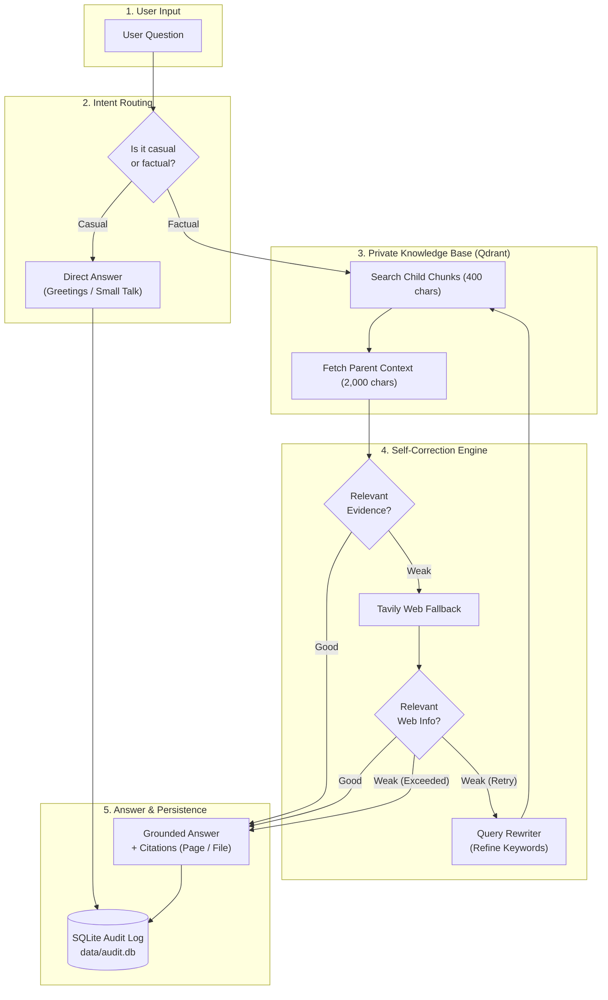

# Agentic RAG: Self-Corrective AI Assistant

An intelligent **Agentic RAG** system built with **LangGraph**, **NVIDIA NIM**, **Qdrant Cloud**, and **Tavily Web Search**.

Unlike traditional RAG systems that blindly trust vector search, this agent **fact-checks retrieved evidence**, automatically **falls back to web search** when internal documents are insufficient, and **rewrites queries** to find accurate answers with exact page citations.

---

## Architecture Block Diagram



---

## Key Features

- **Self-Corrective Loop**: Validates context before answering. If private documents lack answers, it automatically searches the live web via Tavily.
- **Hierarchical Chunking (Parent-Child)**:
  - **Child chunks (400 chars)**: Embedded with file & page metadata for pinpoint vector search.
  - **Parent chunks (2,000 chars)**: Retrieved for generation to preserve full context and prevent hallucinations.
- **Dual Interface**:
  - **CLI Runner**: Interactive terminal streaming of reasoning steps and citations.
  - **Headless API**: FastAPI endpoints (`/api/chat`, `/api/ingest`, `/api/health`).
- **Audit Trail**: Logs questions, routing decisions, citations, and execution traces in SQLite (`data/audit.db`).

---

## Quickstart

### 1. Installation

```bash
# Clone the repository
git clone <repo-url>
cd "Agentic RAG"

# Create and activate virtual environment
python -m venv .venv
.venv\Scripts\activate       # Windows
# source .venv/bin/activate  # Linux / Mac

# Install requirements
pip install -r requirements.txt
```

### 2. Environment Variables (`.env`)

Create a `.env` file in the project root:

```ini
NVIDIA_API_KEY=your_nvidia_api_key
TAVILY_API_KEY=your_tavily_api_key
QDRANT_API_KEY=your_qdrant_api_key
CLUSTER_END_POINT=https://your-cluster.cloud.qdrant.io:6333
QDRANT_INDEX_NAME=STORAGE
QDRANT_NAME_SPACE=DEFAULT
NVIDIA_CHAT_MODEL=nvidia/nemotron-3.5-lightning-30b-a3b
NVIDIA_EMBEDDING_MODEL=nvidia/nemotron-3.5-embed-1b
ADMIN_API_KEY=localhost
```

---

## How to Use

### Option A: CLI Runner (Recommended)

```bash
# 1. Ingest a document (.pdf, .docx, .txt, .md)
python run.py --ingest "path/to/document.pdf"

# 2. Ask a question directly
python run.py "What are the main paradigms of RAG?"

# 3. Or launch interactive REPL mode
python run.py
```

### Option B: FastAPI Microservice

```bash
# Start the server
uvicorn app.main:app --port 8080 --reload
```

- **Health Check**: `GET http://localhost:8080/api/health`
- **Chat Endpoint**: `POST http://localhost:8080/api/chat`
  ```json
  {
    "question": "Explain Modular RAG from the survey"
  }
  ```
- **Upload Document**: `POST http://localhost:8080/api/ingest` (multipart form with `file` and header `x-admin-key: localhost`)

---

## Project Structure

```text
├── app/
│   ├── api/routes.py         # REST endpoints (/api/chat, /api/ingest)
│   ├── core/config.py        # Settings & .env loader
│   ├── rag/
│   │   ├── state.py          # LangGraph state schema
│   │   ├── vector_stores.py  # Qdrant client & embedding logic
│   │   └── workflow.py       # LangGraph agent nodes & conditional edges
│   └── services/
│       ├── audit.py          # SQLite query logger
│       └── ingestion.py      # Document loader & parent-child chunker
├── run.py                    # Interactive CLI runner
├── requirements.txt          # Dependencies
└── .env                      # Configuration
```

---

## License

Apache 2.0
