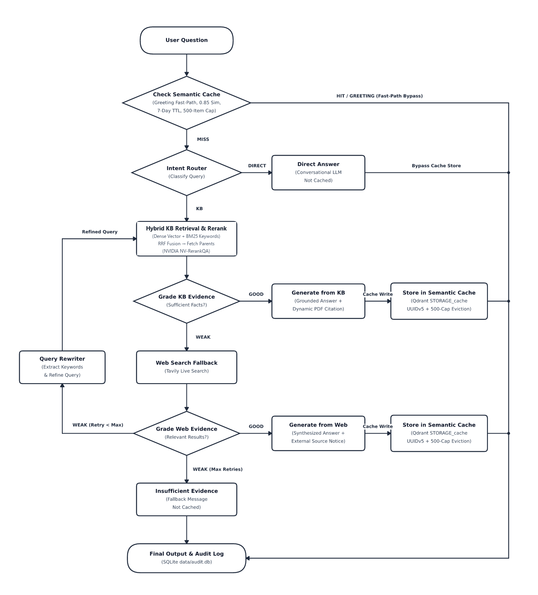

# Agentic RAG: Self-Corrective AI Assistant

An intelligent **Agentic RAG** system built with **LangGraph**, **NVIDIA NIM**, **Qdrant Cloud**, and **Tavily Web Search**.

Unlike traditional RAG systems that blindly trust vector search, this agent **fact-checks retrieved evidence**, automatically **falls back to web search** when internal documents are insufficient, and **rewrites queries** to find accurate answers with exact page citations.

---

## Architecture Flow



The pipeline executes a self-corrective LangGraph workflow:
1. **Semantic Cache Check**: Intercepts greetings and checks cosine similarity against previously answered questions in Qdrant before invoking models.
2. **Intent Routing**: Classifies the query as casual conversation (`direct`) or requiring documentation (`kb`).
3. **Hybrid Retrieval**: Queries child chunks using dense Qdrant vector search and BM25 keyword matching, then merges candidates using Reciprocal Rank Fusion (RRF).
4. **NVIDIA Reranking**: Re-scores parent chunks using `nvidia/llama-nemotron-rerank-vl-1b-v2` to prioritize the most relevant context.
5. **Evidence Grading**: Evaluates whether retrieved chunks contain sufficient facts to answer the question.
6. **Web Search Fallback**: Automatically invokes Tavily if private documents lack adequate evidence.
7. **Query Rewriter**: Reformulates search keywords if web evidence is also insufficient (retries up to `max_retries`).
8. **Answer Generation**: Synthesizes grounded answers citing specific filenames and page numbers, then caches the grounded response.

---

## Key Features

- **Semantic Caching & Resource Safeguards**: Qdrant-backed cache stores previous answers based on cosine similarity, bypassing expensive LLM/embedding calls for repeat questions. Includes a zero-cost greeting interceptor, 7-day TTL expiration, 500-item size cap, and automatic cache invalidation upon document ingestion.
- **Hybrid Search (BM25 + Dense + RRF)**: Combines keyword-based BM25 retrieval with dense vector search via Reciprocal Rank Fusion, ensuring exact terms and rare technical entities are never missed.
- **Reranking Layer**: Uses NVIDIA NV-Rerank (`nvidia/llama-nemotron-rerank-vl-1b-v2`) to reorder retrieved candidates by semantic relevance, with graceful fallback to fusion order.
- **Multi-Document Synthesis**: Supports answering cross-domain queries spanning multiple ingested documents (e.g. RAG and Operating Systems) within an expanded context window.
- **Hierarchical Chunking (Parent-Child)**:
  - **Child chunks (400 chars)**: Embedded with file & page metadata for pinpoint vector search.
  - **Parent chunks (2,000 chars)**: Retrieved for generation to preserve full context and prevent hallucinations.
- **Self-Corrective Loop**: Validates evidence before generation; dynamically falls back to live Tavily web search when internal documentation is incomplete.
- **Dual Interface**:
  - **CLI Runner**: Interactive terminal streaming of reasoning steps, dynamic trace logs (showing exact filenames), and citations.
  - **Headless API**: FastAPI endpoints (`/api/chat`, `/api/ingest`, `/api/health`).
- **Audit Trail**: Logs questions, routing decisions, citations, and execution traces in SQLite (`data/audit.db`).

---

## Quickstart

### 1. Installation

```bash
# Clone the repository
git clone <repo-url>
cd "Agentic RAG"

# Create and activate virtual environment
python -m venv .venv
.venv\Scripts\activate       # Windows
# source .venv/bin/activate  # Linux / Mac

# Install requirements
pip install -r requirements.txt
```

### 2. Environment Variables (`.env`)

Copy the template and fill in your API keys:

```bash
cp .env.example .env
```

Configuration parameters:

```ini
# ── Required API Keys ──────────────────────────────────────────────
NVIDIA_API_KEY=your_nvidia_api_key
TAVILY_API_KEY=your_tavily_api_key
QDRANT_API_KEY=your_qdrant_api_key

# ── Qdrant Cloud ──────────────────────────────────────────────────
CLUSTER_END_POINT=https://your-cluster.cloud.qdrant.io:6333
QDRANT_INDEX_NAME=STORAGE
QDRANT_NAME_SPACE=DEFAULT

# ── NVIDIA NIM Models ────────────────────────────────────────────
NVIDIA_CHAT_MODEL=nvidia/nemotron-3.5-lightning-30b-a3b
NVIDIA_EMBEDDING_MODEL=nvidia/nemotron-3.5-embed-1b

# ── Security & Limits ────────────────────────────────────────────
ADMIN_API_KEY=localhost
CACHE_SIMILARITY_THRESHOLD=0.85
LOG_LEVEL=WARNING
```

---

## How to Use

### Option A: CLI Runner (Recommended)

```bash
# 1. Ingest documents (.pdf, .docx, .txt, .md)
python run.py --ingest "path/to/document.pdf"

# 2. Ask a question directly
python run.py "What are the main paradigms of RAG?"

# 3. Launch interactive REPL mode
python run.py
```

Inside REPL mode:
- Type your question directly.
- `ingest <path>` — Ingest a document and invalidate the cache.
- `clear-cache` — Manually clear cached answers for the current namespace.
- `flow` — Display the architecture flow banner.
- `exit` — Quit the CLI.

### Option B: FastAPI Microservice

```bash
# Start the server
uvicorn app.main:app --port 8080 --reload
```

- **Health Check**: `GET http://localhost:8080/api/health`
- **Chat Endpoint**: `POST http://localhost:8080/api/chat`
  ```json
  {
    "question": "Explain Modular RAG from the survey"
  }
  ```
- **Upload Document**: `POST http://localhost:8080/api/ingest` (multipart form with `file` and header `x-admin-key: localhost`)

---

## Project Structure

```text
├── app/
│   ├── api/
│   │   └── routes.py         # REST endpoints (/api/chat, /api/ingest, /api/health)
│   ├── core/
│   │   ├── config.py         # Settings & .env loader
│   │   └── logging.py        # Log formatting & noise suppression
│   ├── rag/
│   │   ├── state.py          # LangGraph state schema (AgentState)
│   │   ├── vector_stores.py  # Qdrant client & embedding logic
│   │   ├── bm25.py           # In-memory BM25 index & invalidation
│   │   ├── rank_fusion.py    # Reciprocal Rank Fusion (RRF)
│   │   ├── reranking.py      # NVIDIA NV-Rerank layer
│   │   ├── llm.py            # ChatNVIDIA & Tavily tool singletons
│   │   ├── cache_nodes.py    # Semantic cache lookup node & routing
│   │   ├── router.py         # Intent classification node (kb vs direct)
│   │   ├── retrieval.py      # Hybrid retrieval, web search, query rewrite
│   │   ├── grading.py        # Evidence grading nodes (KB & web)
│   │   ├── generation.py     # Grounded answer generation nodes
│   │   └── workflow.py       # LangGraph assembly (build_graph, ask)
│   └── services/
│       ├── audit.py          # SQLite audit logger (data/audit.db)
│       ├── cache.py          # Qdrant semantic cache & TTL/size eviction
│       └── ingestion.py      # Document loader & hierarchical chunker
├── cli/
│   ├── banner.py             # CLI banner and flow diagram text
│   ├── trace_printer.py      # Per-node trace and step printer
│   ├── pipeline.py           # Execution stream runner
│   ├── ingest.py             # CLI document ingestion handler
│   └── repl.py               # Interactive CLI shell
├── project_structure/
│   └── create_project.py     # Directory and file scaffold generator
├── tests/
│   └── test.py               # Integration smoke tests
├── run.py                    # CLI entrypoint (argparse + bootstrap)
├── workflow_diagram.png      # Architecture workflow flowchart
├── requirements.txt          # Python dependencies
├── .env.example              # Environment variables template
└── .env                      # Local configuration (git-ignored)
```

*(Note: SQLite database in `data/` and uploads in `uploads/` are generated at runtime and ignored in version control).*

---

## Roadmap

- [x] **Semantic Caching** — Cosine similarity caching with 7-day TTL and size eviction.
- [x] **Hybrid Search (BM25 + Vector)** — Dense vector search combined with BM25 keyword matching via Reciprocal Rank Fusion.
- [x] **Reranking Layer** — NVIDIA NV-Rerank reorders candidates prior to evidence grading.
- [x] **Multi-Document Synthesis** — Grounded generation across multiple ingested source files in a unified response.
- [ ] **FastAPI Backend Improvements** — Enhanced async handling, request validation, and production optimization.
- [ ] **Interactive Web Frontend** — Modern web interface for chat, document upload, and real-time reasoning trace visualization.
- [ ] **RAG Evaluation** — Automated evaluation metrics for faithfulness, answer relevance, and context precision.
- [ ] **Minor Improvements** — Code polish, expanded file format loaders, and performance tuning.

---

## License

Apache 2.0
